  

# 🚀 Awesome API Design & Definition Studio 🛠️

**A curated index of top-tier visual API editors, OpenAPI 3.1 & AsyncAPI design studios, mock servers, linters, and developer documentation engines.**

  <a href="#-sector-overview--market-dynamics">Sector Overview</a> •
  <a href="#-saas-platforms--commercial-studios">SaaS Platforms</a> •
  <a href="#-open-source-tools--component-libraries">Open Source</a> •
  <a href="#-star-history">Star History</a> •
  <a href="#-support--sponsorship">Support</a> •
  <a href="#-contributing">Contributing</a>

---

## 📈 Sector Overview & Market Dynamics

The global API management and design market is valued between **$8.6B and $10.5B** and is projected to expand beyond **$35B to $41B** by the early 2030s (registering a ~16.5%–25% CAGR). The sector is **moderately fragmented**, balancing hyperscale cloud suites (AWS API Gateway, Microsoft Azure API Management, Google Apigee) against specialized enterprise middleware providers (MuleSoft, SmartBear) and agile, developer-first pure-plays (Postman, Kong, Apidog, ReadMe) competing on developer experience, GitOps workflows, and multi-cloud portability rather than single-vendor lock-in.

---

## ☁️ SaaS Platforms & Commercial Studios

Comprehensive visual design platforms, team collaboration suites, and hosted API hubs.

| 🏢 Product | 📊 Company Scale (Valuation / Revenue) | 💳 Starting Price | 🎁 Free Tier / Trial Limits | 📝 Description |
| :--- | :--- | :--- | :--- | :--- |
| **[Postman](https://www.postman.com/)** | $5.6B Valuation (~$313M ARR) | $14/user/mo (Basic, billed annually) | Free forever: 1 user, 10,000 Postman API calls/mo, 5 integrations, unlimited local collection runs. | Enterprise-grade collaborative API platform providing visual API builders, contract design, automated testing, and mock servers. |
| **[SwaggerHub](https://swagger.io/tools/swaggerhub/)** | ~$2.0B Valuation (~$250M ARR parent SmartBear) | $19/user/mo (Individual, billed annually) | Free forever: 1 user, 1 active public API definition, public documentation, community support. (14-day free trial on Team plans). | Collaborative OpenAPI-first visual modeling, editor, contract governance, and standardized cataloging platform by SmartBear. |
| **[Stoplight](https://stoplight.io/)** | ~$2.0B parent SmartBear (Acquired 2023) | $44/mo (Starter plan, includes up to 3 seats) | Free forever: 1 user, 1 project, basic visual OpenAPI modeling, mock servers, and interactive docs. | API design-first platform featuring visual OpenAPI schema modeling, style guides, mock servers, and developer documentation hubs. |
| **[ReadMe](https://readme.com/)** | $36M Valuation (~$10M ARR) | $79/mo (Startup plan, billed annually) | Free forever (Starter): 1 user/seat, 1 project, 1 published version with interactive API reference and basic documentation. | Interactive developer hubs combining visual API reference generation, real-time API call metrics, guides, and changelogs. |
| **[Apidog](https://apidog.com/)** | ~$10M–$20M ARR (Privately held) | $9/user/mo (Basic, billed annually) | Free forever: Up to 4 users, unlimited collection runs, unlimited mock servers, basic shared projects. | Unified all-in-one API design, visual specification modeling, debugging, mocking, and automated contract testing suite. |
| **[Redocly](https://redocly.com/)** | ~$5M–$15M ARR (Privately held) | $249/mo (Pro tier, billed annually) | 30-day free trial: Full platform access for unlimited users/seats, up to 3 projects/domains, docs-as-code Git sync. (No permanent hosted free tier). | Docs-as-code and API design platform providing OpenAPI linting, visual documentation generation, developer portals, and workflows. |
| **[RepreZen API Studio](https://www.repreZen.com/)** | Boutique Enterprise (~$2M–$5M ARR) | $100/user/mo (Commercial desktop/cloud license) | 30-day free trial: Complete access to RepreZen API Studio IDE, code generators, and RAPID-ML modeling engine. | Eclipse-based and cloud-native API design environment offering complete OpenAPI/Swagger visual modeling, code generation, and live documentation. |

---

## 🌟 Open-Source Tools & Component Libraries

A curated collection of open-source visual editors, API clients, mock engines, linters, and documentation toolkits, sorted by GitHub stargazers:

| 📦 Repository | ⭐ GitHub Stars | 🔍 Key Capabilities & Description |
| :--- | :--- | :--- |
| [Hoppscotch](https://github.com/hoppscotch/hoppscotch)  | 80,767 | Complete open-source API development ecosystem, web/desktop client, and mock engine. |
| [Bruno](https://github.com/usebruno/bruno)  | 48,275 | Fast, git-friendly open-source API client and specification explorer storing collections as plain files. |
| [Insomnia](https://github.com/Kong/insomnia)  | 40,131 | Open-source desktop API client and design platform supporting OpenAPI, GraphQL, and REST. |
| [Swagger UI](https://github.com/swagger-api/swagger-ui)  | 29,078 | Industry-standard OpenAPI visualization tool rendering interactive API documentation dynamically. |
| [Redoc](https://github.com/Redocly/redoc)  | 26,005 | Open-source OpenAPI/Swagger-generated interactive API reference documentation engine. |
| [Scalar](https://github.com/scalar/scalar)  | 16,384 | Modern open-source developer platform for interactive API references and REST client testing. |
| [Swagger Editor](https://github.com/swagger-api/swagger-editor)  | 9,471 | Browser-based editor for designing, modeling, and describing APIs with OpenAPI specifications. |
| [Mockoon](https://github.com/mockoon/mockoon)  | 8,475 | Lightweight local mock API designer and server supporting OpenAPI specifications with zero latency. |
| [Stoplight Prism](https://github.com/stoplightio/prism)  | 5,068 | Open-source HTTP mock server and proxy with real-time OpenAPI contract validation and response mocking. |
| [Stoplight Spectral](https://github.com/stoplightio/spectral)  | 3,252 | Flexible JSON/YAML API linter and style-guide validator supporting OpenAPI v2/v3 and AsyncAPI. |
| [Stoplight Elements](https://github.com/stoplightio/elements)  | 2,473 | Embeddable UI component library rendering interactive API documentation from OpenAPI specs. |
| [Apicurio Studio](https://github.com/Apicurio/apicurio-studio)  | 1,055 | Open-source web-based API design studio for OpenAPI and AsyncAPI (community edition/archived). |
| [AsyncAPI Studio](https://github.com/asyncapi/studio)  | 213 | Official browser-based visual modeling and editing studio for AsyncAPI event-driven definitions. |

---

## 📊 Star History

---

## 💖 Support & Sponsorship

Thank you so much for exploring and supporting **Awesome API Design & Definition Studio**! 🌟

If you found this curated list helpful, please consider:
- ⭐ **Starring** the repository on GitHub to help others discover it.
- 🍴 **Forking** and contributing new tools, studios, or corrections.
- 📢 **Sharing** with your network, team, or developer communities.
- ☕ **Buying a coffee or sponsoring** future development and maintenance via the [GitHub Sponsors Dashboard](https://github.com/sponsors/ishandutta2007).

Your support keeps this directory fresh, accurate, and actively maintained! 🙌

---

## 🤝 Contributing

Contributions, issues, and feature requests are welcome! Feel free to check the [issues page](../../issues) or submit a Pull Request following our curated standards.
